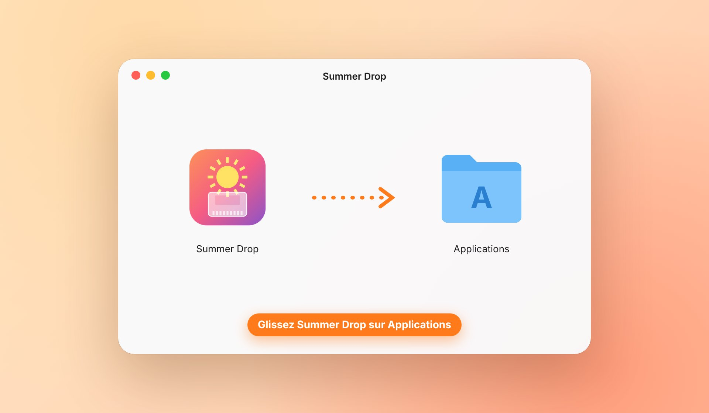
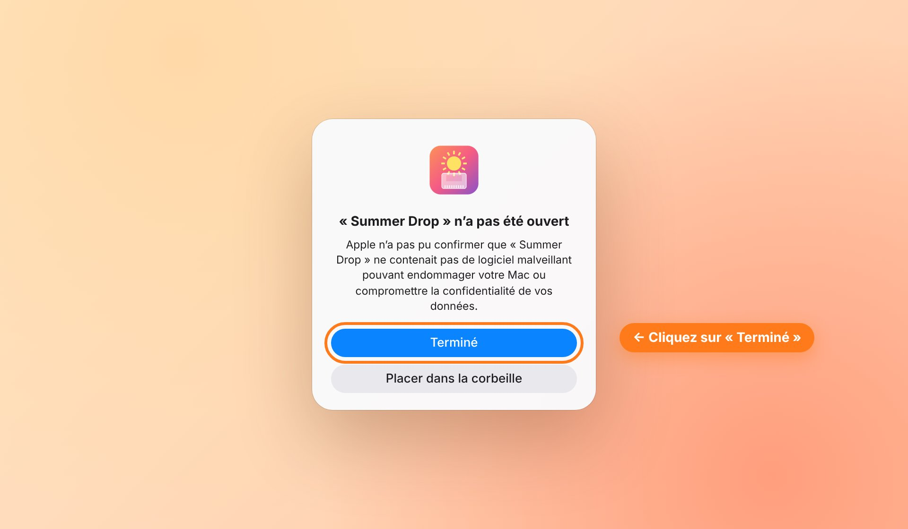
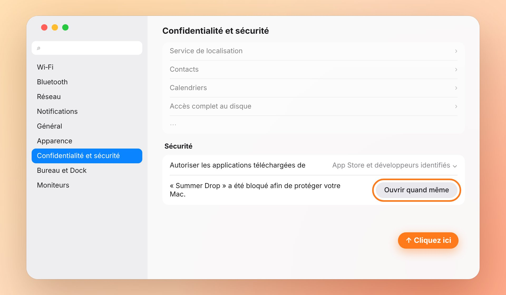
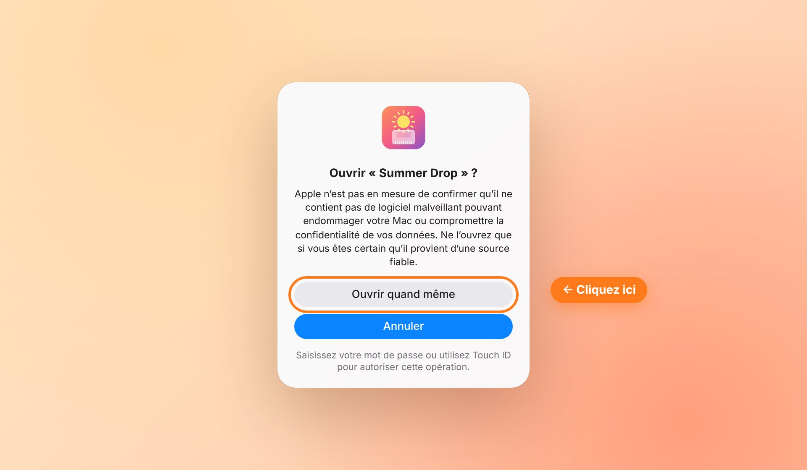

# ☀️ Summer Drop

[English](README.md) · **Français**

App Mac native (SwiftUI, Liquid Glass de macOS 26) pour envoyer des ROM N64 sur la carte SD d'une [SummerCart64](https://github.com/Polprzewodnikowy/SummerCart64) par USB-C, et les récupérer, sans Terminal et sans retirer la microSD.

## Fonctions

- **Deux panneaux** : un dossier du Mac à gauche (par défaut `iCloud Drive › Documents › Jeux › Nintendo 64`), la carte SD de la cartouche à droite. Glissez des ROM de l'un à l'autre, ou depuis le Finder. Les dossiers entiers sont acceptés.
- **Clavier** : cliquez sur un panneau, puis **⌘A** tout sélectionner, **⌘C** copier, **⌘X** déplacer (toujours confirmé ; les fichiers du Mac vont à la corbeille), **⌘V** coller dans l'autre panneau. **⌘K** pour rechercher.
- **Fiches de jeu** au survol : jaquette, écran-titre, capture, année, développeur, éditeur, genres, résumé Wikipédia, région, langues, taille et format. Pour les noms de ROM inhabituels : titres alternatifs de Wikidata, puis l'IA d'Apple sur l'appareil en dernier recours (sans clé, rien ne quitte le Mac).
- **Vos étoiles** (1 à 5), gardées sur le Mac.
- **Progression** par fichier et totale, **notifications** à la fin des transferts, au branchement de la cartouche et quand une mise à jour est prête.
- **Statistiques** : ROM envoyées et récupérées, volumes, vitesses moyennes.
- **8 langues** : English, Français, Español, Deutsch, Italiano, Português, 日本語, 简体中文. Suit la langue du Mac, ou se choisit dans le tutoriel ou les Réglages ; le changement est immédiat.
- **Tri et groupes** dans chaque panneau (bouton ↑↓) : par nom, taille, date, note ou région ; groupes par première lettre, région, note ou format.
- **Réglages** (⌘,) : langue, thème Automatique / Clair / Sombre, dossier de téléchargement, emplacement de `sc64deployer`, notifications, fiches de jeu, mises à jour.
- **Tutoriel** au premier lancement, qui commence par le choix de la langue (flèches pour naviguer, ⌘↩ pour terminer), rejouable depuis le menu Aide.
- **Mises à jour automatiques** depuis les versions GitHub.
- N'écrase jamais un fichier du Mac. Refuse d'accéder à la carte quand la console est allumée.

## Installer

Téléchargez **SummerDrop.dmg** dans la [dernière version](https://github.com/Titelive/summer-drop/releases/latest). `sc64deployer` est inclus, il n'y a rien d'autre à installer.

### Ouvrir l'app la première fois

Summer Drop est gratuite et n'est pas notariée par Apple (il faut pour cela un compte développeur payant). macOS vous demande donc de confirmer le tout premier lancement. Cela prend une minute et n'arrive qu'une fois : les mises à jour suivantes s'installent sans rien redemander.

**1. Installez l'app.** Double-cliquez sur `SummerDrop.dmg`, puis glissez **Summer Drop** sur le dossier **Applications**.



**2. Ouvrez-la une première fois.** Double-cliquez sur **Summer Drop** dans Applications. macOS indique qu'il n'a pas pu vérifier l'app. Cliquez sur **Terminé** (pas sur *Placer dans la corbeille*).



**3. Autorisez-la dans les Réglages Système.** Ouvrez le menu Pomme  › **Réglages Système** › **Confidentialité et sécurité**, puis descendez jusqu'à **Sécurité**. À côté de *« Summer Drop » a été bloqué afin de protéger votre Mac*, cliquez sur **Ouvrir quand même**. Le bouton reste affiché environ une heure après l'étape 2.



**4. Confirmez.** Cliquez à nouveau sur **Ouvrir quand même**, puis saisissez le mot de passe du Mac ou utilisez Touch ID. Summer Drop s'ouvre sur son tutoriel de bienvenue, où vous choisissez votre langue.



<details>
<summary>Vous préférez le Terminal ?</summary>

Cette seule commande remplace les étapes 2 à 4 :

```sh
xattr -dr com.apple.quarantine "/Applications/Summer Drop.app"
```
</details>

> Les images ci-dessus sont des illustrations. L'apparence exacte des fenêtres de macOS peut légèrement varier.

**Prérequis :** Mac Apple Silicon, **macOS 26** ou plus récent, firmware SummerCart64 2.20.0 ou plus.

## Mises à jour automatiques

L'app vérifie GitHub au lancement puis toutes les 6 heures (ou **Summer Drop › Rechercher des mises à jour…**). Si une version plus récente existe, elle télécharge l'image disque et affiche **« Version X prête · Redémarrer »**. Sans clic, elle s'installe quand vous quittez l'app.

### Publier une version

Sur GitHub : **Actions › Compiler et publier › Run workflow**, tapez un numéro (par exemple `1.5.0`) et validez. GitHub Actions compile l'app sur un Mac macOS 26, y inclut le dernier `sc64deployer` officiel, crée `SummerDrop.dmg` et publie la version.

## Compiler soi-même

Xcode 26 ou Command Line Tools à jour (`xcode-select --install`).

```bash
./build.sh              # build/Summer Drop.app
./build.sh --dmg        # crée aussi build/SummerDrop.dmg
./build.sh --install    # compile et copie dans iCloud Drive/Documents/Jeux/Analogue 3D
```

## Bon à savoir

- **Éteignez la console** avant d'accéder à la carte SD.
- `sc64deployer` n'indique pas d'avancement pendant un transfert : les barres sont **estimées** d'après la taille et le débit mesuré, et n'atteignent 100 % qu'à la vraie fin.
- Envoyer un fichier qui porte le même nom qu'un fichier de la carte le **remplace**.

## Crédits

Créé par [Titelive](https://titelive.me/prestations/) · [Offrir un café](https://buymeacoffee.com/titelive) ☕
SummerCart64 et `sc64deployer` par Mateusz Faderewski ([Polprzewodnikowy](https://github.com/Polprzewodnikowy/SummerCart64)).
Non affilié à Nintendo ni à Analogue.
