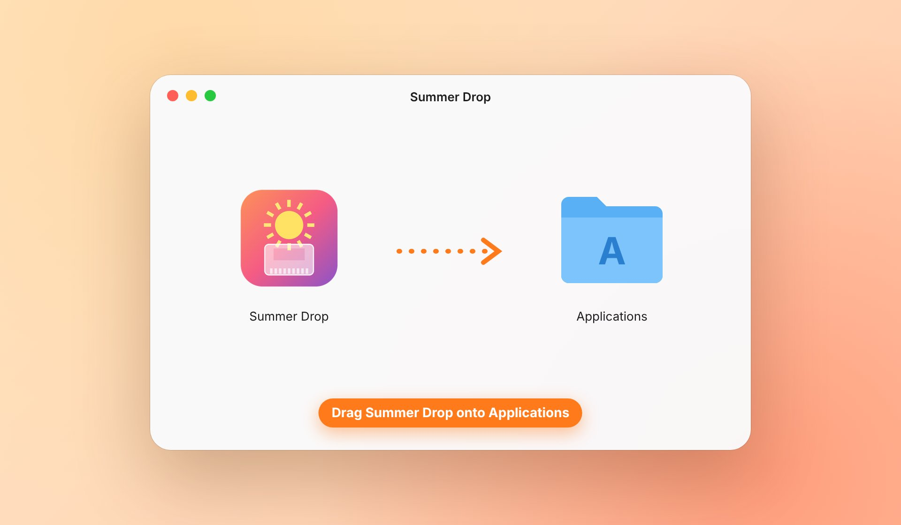
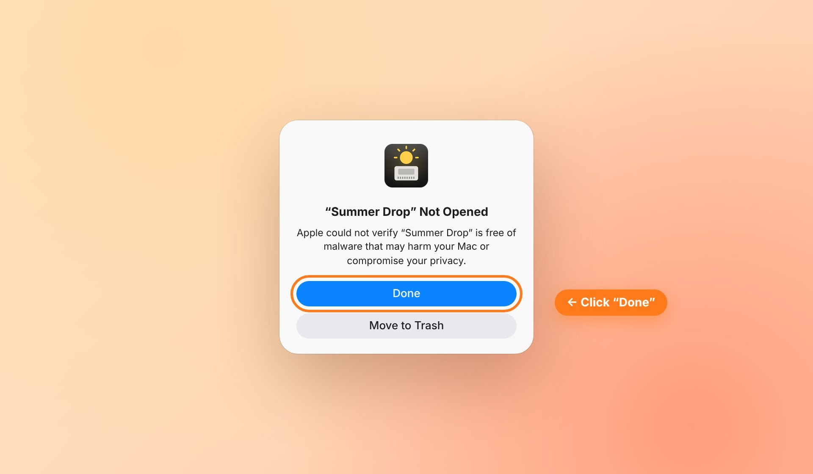
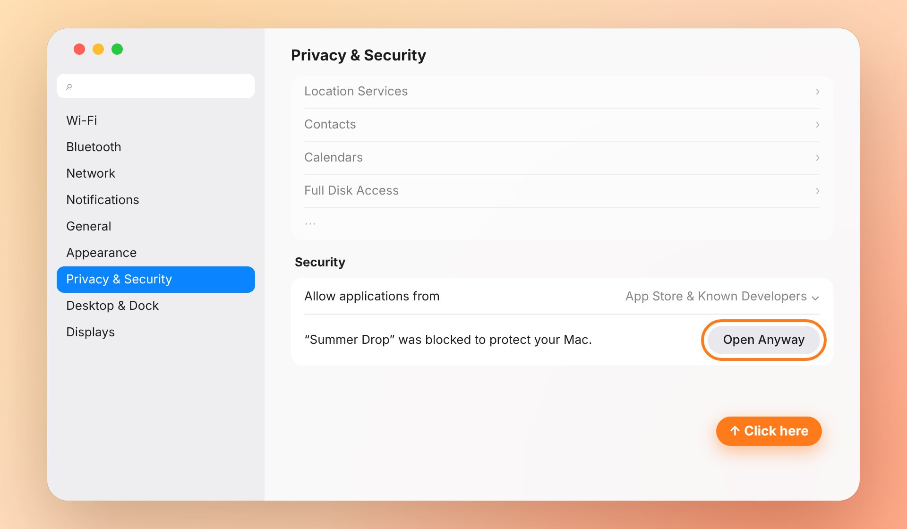
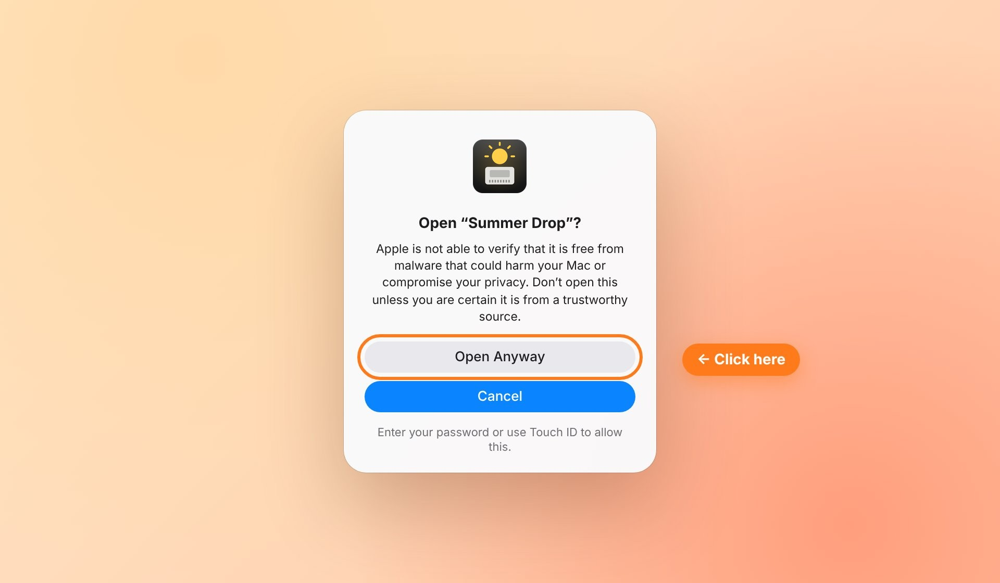

# ☀️ Summer Drop

**English** · [Français](README.fr.md)

A native Mac app (SwiftUI, macOS 26 Liquid Glass) to send N64 ROMs to the SD card of a [SummerCart64](https://github.com/Polprzewodnikowy/SummerCart64) over USB-C, and get them back, without the Terminal and without pulling the microSD card.

## Features

- **Two panes**: a folder of your Mac on the left (default `iCloud Drive › Documents › Jeux › Nintendo 64`), the cartridge SD card on the right. Drag ROMs from one to the other, or from the Finder. Whole folders are accepted.
- **Keyboard**: click a pane, then **⌘A** select all, **⌘C** copy, **⌘X** move (always confirmed; Mac files go to the Trash), **⌘V** paste into the other pane. **⌘K** search.
- **Game cards** on hover: box art, title screen, screenshot, year, developer, publisher, genres, Wikipedia summary, region, languages, size and format. When a ROM name is unusual, alternate titles from Wikidata are used, then Apple's on-device model as a last resort (no API key, nothing leaves the Mac).
- **Your own star ratings** (1 to 5), stored on the Mac.
- **Progress** per file and overall, **notifications** when transfers finish, when the cartridge is plugged or unplugged, and when an update is ready. Each kind has its own switch; they only show while the app is in the background, respect Focus, and a click opens the right screen. Permission is asked at the first transfer, not at launch.
- **Statistics**: ROMs sent and retrieved, volumes, average speeds.
- **8 languages**: English, Français, Español, Deutsch, Italiano, Português, 日本語, 简体中文. Follows your Mac, or pick one in the tutorial or in Settings; it switches instantly.
- **Sort and group** each pane (↑↓ button): by name, size, date, rating or region; groups by first letter, region, rating or format.
- **Settings** (⌘,): language, Automatic / Light / Dark theme (Automatic follows macOS live, with a cross-fade), download folder, `sc64deployer` location, notifications, game cards, updates.
- **Welcome tutorial** on first launch, starting with the language choice (arrow keys to navigate, ⌘↩ to finish), available again from the Help menu.
- **Automatic updates** from GitHub Releases.
- Never overwrites a file on the Mac. Refuses to touch the SD card while the console is on.

## Install

Download **SummerDrop.dmg** from the [latest release](https://github.com/Titelive/summer-drop/releases/latest). `sc64deployer` is bundled, there is nothing else to install.

### Opening the app the first time

Summer Drop is free and is not notarized by Apple (that needs a paid developer account), so macOS asks you to confirm the very first launch. It takes one minute and only happens once: later updates install without asking again.

**1. Install the app.** Double-click `SummerDrop.dmg`, then drag **Summer Drop** onto the **Applications** folder.



**2. Open it once.** Double-click **Summer Drop** in Applications. macOS says it could not verify the app. Click **Done** (not *Move to Trash*).



**3. Allow it in System Settings.** Open the Apple menu  › **System Settings** › **Privacy & Security** and scroll down to **Security**. Next to *“Summer Drop” was blocked to protect your Mac*, click **Open Anyway**. The button stays there for about an hour after step 2.



**4. Confirm.** Click **Open Anyway** again, then enter your Mac password or use Touch ID. Summer Drop opens on its welcome tutorial, where you pick your language.



<details>
<summary>Prefer the Terminal?</summary>

This one command does steps 2 to 4 at once:

```sh
xattr -dr com.apple.quarantine "/Applications/Summer Drop.app"
```
</details>

> The pictures above are illustrations. The exact look of the macOS windows can differ slightly.

**Requirements:** Apple silicon Mac, **macOS 26** or later, SummerCart64 firmware 2.20.0 or later.

## Automatic updates

The app checks GitHub at launch and every 6 hours (or **Summer Drop › Check for Updates…**). When a newer version exists, it downloads the disk image and shows **"Version X ready · Restart"**. If you don't click, it installs when you quit the app.

### Publishing a version

On GitHub: **Actions › Compiler et publier › Run workflow**, type a version number such as `1.5.0`, and run. GitHub Actions builds the app on a macOS 26 runner, bundles the latest official `sc64deployer`, creates `SummerDrop.dmg` and publishes the release. Installed apps then offer it on their own.

## Build it yourself

Requires Xcode 26 or up-to-date Command Line Tools (`xcode-select --install`).

```bash
./build.sh              # build/Summer Drop.app
./build.sh --dmg        # also build/SummerDrop.dmg
./build.sh --install    # build and copy to iCloud Drive/Documents/Jeux/Analogue 3D
```

`build.sh` bundles `sc64deployer` if it finds it next to the project or in `iCloud Drive/Documents/Jeux/Analogue 3D/`, then signs the app ad hoc.

## Where the app looks for `sc64deployer`

1. the path chosen in Settings or the tutorial;
2. next to the app;
3. inside the app (`Contents/Resources`);
4. `iCloud Drive/Documents/Jeux/Analogue 3D/sc64deployer`;
5. `/opt/homebrew/bin`, then `/usr/local/bin`.

## Good to know

- **Turn the console off** before accessing the SD card.
- `sc64deployer` does not report progress during a transfer, so progress bars are **estimated** from file size and the speed measured on earlier transfers. They reach 100% only when the transfer really ends.
- Sending a file with the same name as one on the card **replaces** it.

## Project layout

```
Sources/
  SummerDropApp.swift    entry point, windows, menus
  ContentView.swift      main window (Liquid Glass)
  MacPanelView.swift     Mac pane, drag and drop
  AppModel.swift         state, transfer queue, cartridge detection, clipboard
  Deployer.swift         runs sc64deployer and parses its output
  GameInfoService.swift  game cards (Wikipedia, Wikidata, libretro thumbnails)
  ThumbnailIndex.swift   thumbnail lookup, on-device AI fallback
  GameCardView.swift     game card and star ratings
  Updater.swift          automatic updates from GitHub Releases
  Notifier.swift         macOS notifications
  SettingsView.swift, OnboardingView.swift, AboutView.swift, StatsView.swift, CreatorViews.swift
Tools/GameInfoCheck.swift   CI check of the online game card sources
build.sh                    build script
```

## Credits

Made by [Titelive](https://titelive.me/prestations/) · [Buy me a coffee](https://buymeacoffee.com/titelive) ☕
SummerCart64 and `sc64deployer` by Mateusz Faderewski ([Polprzewodnikowy](https://github.com/Polprzewodnikowy/SummerCart64)).
Not affiliated with Nintendo or Analogue.
